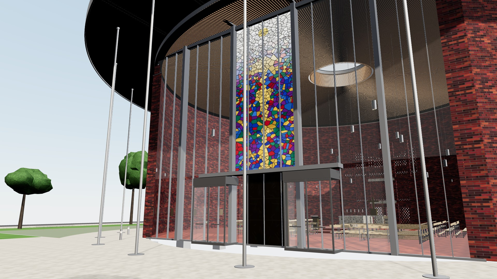

# St. Johann von Capistran, München · 3D 模型包

Sep Ruf 設計，1958–1960 年建成，位於慕尼黑 Parkstadt Bogenhausen（Gotthelfstraße 3）。
這份模型包含建築本體、室內裝修、禮儀陳設、燈具與燈光、基地環境，適用於 **Rhino 7/8** 與 **SketchUp 2017 以後版本**。



## 檔案

| 檔案 | 用途 |
|---|---|
| `output/St_Johann_von_Capistran_Muenchen.3dm` | **Rhino 主檔**：61 個圖層、44 種材質（含貼圖與凹凸貼圖）、10 個圖塊、165 盞 Rhino 燈光、10 個命名視角、慕尼黑太陽位置 |
| `output/St_Johann_von_Capistran_Muenchen_SketchUp.dae` | **SketchUp 匯入檔**（COLLADA），保留群組階層、材質貼圖，重複物件會成為元件 |
| `output/St_Johann_von_Capistran_Muenchen.obj` + `.mtl` | 通用格式（3ds Max、Blender、D5、Twinmotion 等） |
| `output/St_Johann_von_Capistran_Muenchen.glb` | glTF，含燈光，可直接拖進網頁檢視器或 Blender |
| `output/textures/` | 23 張程序化貼圖與 10 張凹凸貼圖，**必須和模型檔放在同一層資料夾** |
| `output/lights_schedule.csv` | 全部燈光的位置、方向、色溫、瓦數表 |
| `output/named_views.json` | 10 個相機視角 |
| `previews/` | 13 張預覽渲染圖 |
| `tools/` | 生成程式（Python），可重跑或修改參數 |

單位為公尺，Z 軸向上，X 軸為東，Y 軸為北。原點為外圓圓心（也就是穹頂中心軸）在室內完成地面 ±0.00 的位置。

## 在 Rhino 中使用

1. 開啟 `.3dm`，保持 `textures/` 資料夾在旁邊。
2. 若貼圖顯示為缺失：`Options → Files → Search paths` 加入 `textures` 資料夾。
3. 命名視角：`_NamedView`，共有 10 個，從「01 Exterior」到「10 Baptistery」。
4. 燈光在 `11_Lights` 圖層下分組，可個別開關：吊燈、壁燈、迴廊光縫霓虹、穹頂光環、重點聚光、外部步道燈。`Exterior Soffit Wallwash (optional)` 預設關閉。
5. 太陽已設為慕尼黑（48.148°N, 11.634°E），2026 年 6 月 21 日 17:30（夏令時間），可在 `Sun` 面板調整。
6. 想要 SketchUp 原生 `.skp`：Rhino 8 中 `File → Save As → SketchUp (*.skp)` 即可。

## 在 SketchUp 中使用

1. `File → Import`，檔案類型選 **COLLADA (*.dae)**。
2. 在 Options 中**不要**勾選 “Merge coplanar faces”，保持 “Validate COLLADA file” 開啟。
3. 匯入後選取全部 → 右鍵 `Soften/Smooth Edges`，角度設 20–30°，曲牆與穹頂會變平滑。
4. 長椅、拉桿柱、配重、吊燈、壁燈、步道燈、樹木都會成為**元件**，改一個就會全部更新。
5. SketchUp 本身沒有燈光物件。燈具已建模並帶有自發光材質（`Emissive_*`）。使用 V-Ray、Enscape、D5 時：
   * Enscape／D5：把 `Emissive_Diffuser_2700K` 與 `Emissive_Neon_3500K` 設為自發光即可。
   * V-Ray：依 `lights_schedule.csv` 的座標放置 IES 或球燈。

## 圖層結構

`00_Reference` 平面參考圓、軸線、中德雙語標籤、圖塊定義 ·
`01_Site` 鋪面、草地、街道、圍牆、樹木 ·
`02_Ancillary` 堂區大廳、鐘牆與三口鐘、神父宅、Henselmann 雕像、鄰房量體 ·
`03_Structure` 雙層磚牆、鏤空磚格柵、22 根拉桿柱、地下配重（預設隱藏）、鋼環梁 ·
`04_Roof` 銅屋頂、鋁簷口、深色木條挑簷底、穹頂採光筒、Plexiglas 穹頂 ·
`05_Facade` 西側玻璃門面、四根鋼梁壁柱、Oberberger 彩繪玻璃、銅門、風除室 ·
`06_Interior` 紅色缸磚地坪、放射狀雲杉木條天花（560 根）、吸音磚面 ·
`07_Liturgy` 祭壇台階、Nagelfluh 礫岩主祭壇、聖體龕、讀經台、洗禮池、聖母像、14 處苦路浮雕 ·
`08_Furniture` 長椅（兩種長度的元件） ·
`09_Crescent` 月牙形夾層的樓板、隔間、樓梯、管風琴 ·
`10_Luminaires` 燈具實體 ·
`11_Lights` Rhino 燈光

## 依據與推估

**有史料依據的尺寸**（Kirchenkurzführer 2012；*Bauen + Wohnen* 17/1963, Heft 2, doi:10.5169/seals-331550）：
外圓直徑 32.00 m，內圓直徑 28.00 m，兩圓偏心，東側夾層寬 4.00 m 共 4 層，兩圓在西側入口相接；
牆高 12.50 m；含穹頂總高 16.00 m；Plexiglas 穹頂直徑 5.00 m；屋頂挑出 4.50 m；
22 根鐵製拉桿柱，間距 5.35 m，末端吊掛數噸重混凝土配重，懸空於地下坑中；
Nagelfluh 礫岩祭壇 2 × 2 m；鐘牆高 13.5 m、寬 12.5 m；
西側玻璃門面由四根屋頂鋼梁分段；東牆下段的鏤空磚格柵後方有窗；10 處不勾縫吸音磚面；
天花為放射狀淺色木條，延伸進採光筒；迴廊光縫內的霓虹燈與穹頂光環。

**依照片與平面草圖推估**：牆厚（外 0.49 m、內 0.365 m）、各樓板標高（+3.00 唱詩台、+6.00 管風琴、+10.25 迴廊）、
側門位置（外牆 ±71°，內牆 ±56°）、天花曲面輪廓、長椅配置（依 1960 年祭壇居中的平面）、樓梯、管風琴管列、
基地配置與附屬建築量體。

**詮釋性處理**：Oberberger 的「耶西之根」彩繪玻璃、Kirchner 的青銅門浮雕、Knappe 的苦路浮雕、
Henselmann 的雕像，都以抽象化的程序貼圖或簡化量體表現，並非原作複製。
磚材為慕尼黑硬燒面磚（NF 240×115×71，10 mm 灰縫）的程序化貼圖。

## 重新生成

```bash
pip install rhino3dm shapely mapbox-earcut numpy pillow
python3 tools/main.py          # 加 --retex 會重算貼圖
```

關鍵參數集中在 `tools/build.py` 開頭（圓半徑、牆高、迴廊標高、天花輪廓等）。
