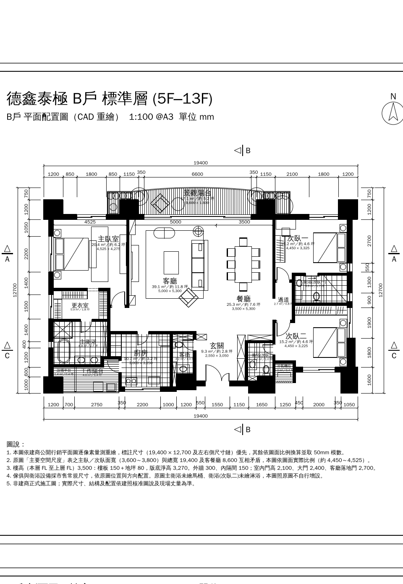
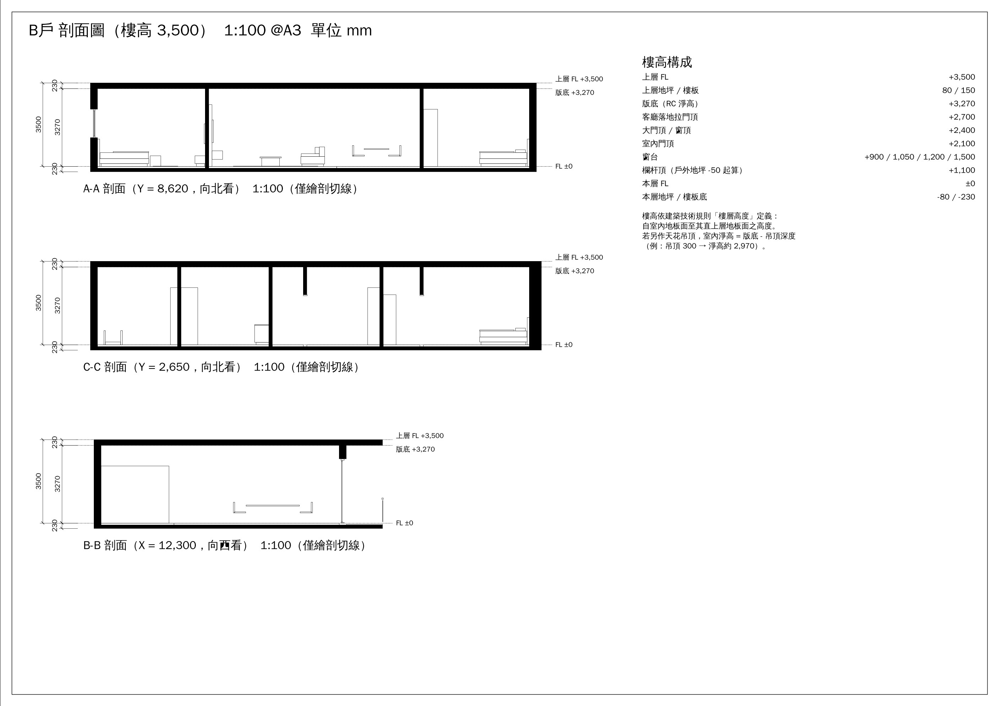
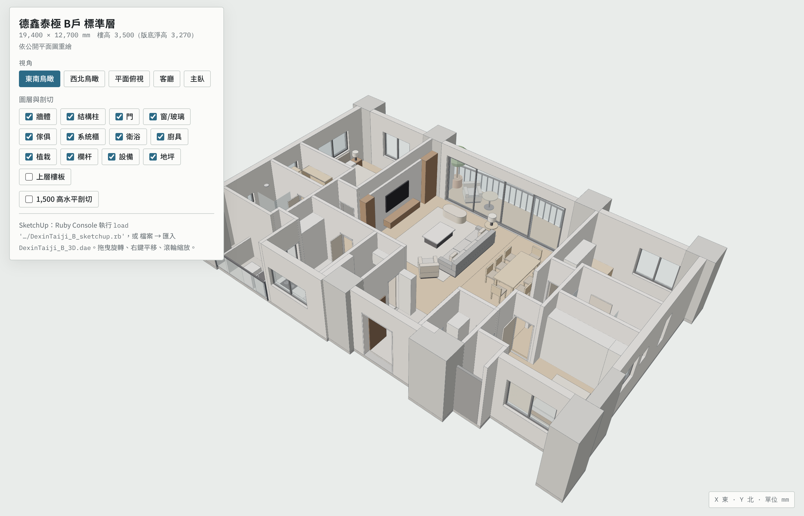

# 德鑫泰極 B戶 標準層：CAD + 3D（樓高 3,500）

依建商公開的「B戶 標準層平面配置圖」逐像素量測重繪。所有隔間、柱、門窗、傢俱、衛浴與廚具都來自同一份幾何數據 `src/model.py`，CAD 平面、剖面與 3D 模型互相一致。





## 樓高設定

| 項目 | 高程 |
|---|---:|
| **樓高（本層 FL 至上層 FL）** | **3,500** |
| 上層地坪 / 上層樓板 | 80 / 150 |
| 版底（RC 淨高）| +3,270 |
| 客廳落地拉門頂 | +2,700 |
| 大門頂 / 窗頂 | +2,400 |
| 室內門頂 | +2,100 |
| 本層 FL | ±0 |
| 本層地坪 / 樓板底 | -80 / -230 |

樓高採《建築技術規則》「樓層高度」定義：自室內地板面至其直上層地板面之高度。若之後做天花吊頂，室內淨高 = 3,270 - 吊頂深度。要改成「室內淨高 3,500」，把 `src/model.py` 的 `FLOOR_TO_FLOOR` 改成 3730 重跑即可。

## 交付檔案（`output/`，另有全部打包的 `DexinTaiji_B_FL3500.zip`）

| 檔案 | 格式 | 開啟軟體 |
|---|---|---|
| `DexinTaiji_B_plan.dxf` | **2D CAD**：平面 + A-A／B-B／C-C 剖面，1:1 mm，分圖層，兩張 A3@1:100 圖框 | AutoCAD、ArchiCAD、Vectorworks、SketchUp Pro |
| `DexinTaiji_B_plan_A3.pdf` | 2 頁出圖（平面、剖面）| 任何 PDF |
| `DexinTaiji_B_3D.dxf` | **3D CAD**：Polyface 實體網格，依圖層分類，mm | AutoCAD、Rhino、Revit、SketchUp Pro |
| `DexinTaiji_B_sketchup.rb` | SketchUp 原生建模腳本（群組、元件、標籤、材質、場景）| SketchUp 2017+ |
| `DexinTaiji_B_3D.dae` | COLLADA，公尺，Z 朝上 | SketchUp「檔案 → 匯入」、3ds Max、Rhino |
| `DexinTaiji_B_3D_m.obj` + `.mtl` | OBJ，公尺，Z 朝上，含材質色 | Blender、Rhino、C4D、3ds Max、Lumion |
| `DexinTaiji_B_3D.glb` | glTF 2.0 | Blender、Twinmotion、Enscape、網頁 |
| `DexinTaiji_B_3D_viewer.html` | 單檔 3D 預覽器 | 瀏覽器 |

上層樓板是獨立的圖層／群組：SketchUp 標籤「A-SLAB-UP」預設隱藏，3D DXF 圖層預設關閉，DAE／OBJ 內為獨立群組 `A-SLAB-UP`，要看室內請先隱藏它。

## 在 SketchUp 中建立模型

**方法 A（推薦，原生幾何）**：延伸程式 → Developer → Ruby Console，輸入：

```ruby
load 'C:/你的路徑/DexinTaiji_B_sketchup.rb'
```

產出單位 mm；每件傢俱是元件（同款餐椅共用一個定義）；標籤依 CAD 圖層命名；場景含「鳥瞰（東南）」「鳥瞰（西北）」「平面俯視」「客廳往陽台」。

**方法 B**：檔案 → 匯入 → `DexinTaiji_B_3D.dae`。

## 2D CAD 圖層

A-WALL 牆體 · A-WALL-LOW 矮牆 · A-COLS 結構柱 · A-DOOR 門/門弧 · A-GLAZ 窗/玻璃 · A-FURN 活動傢俱 · A-CASE 系統櫃 · A-PFIX 衛浴設備 · A-KITC 廚具 · A-EQPT 設備/管道間 · A-PLNT 植栽 · A-RAIL 欄杆 · A-FLOR 地坪 · A-SECT 剖面切線 · A-SECT-LEVL 高程線 · A-ANNO-TEXT 名稱/面積 · A-ANNO-DIMS 尺寸 · A-ANNO-SYMB 剖面符號/指北 · A-SHEET 圖框

中文字型設定為微軟正黑體 `msjh.ttc`。需要 DWG 時，用 AutoCAD 開 DXF 後「另存為 DWG」即可，幾何與圖層完全保留。

## 尺寸怎麼來的

1. **控制尺寸照原圖標註**：總寬 19,400、總深 12,700；左側尺寸鏈 1,800／4,500／3,300／3,100、右側 1,800／5,400／2,300／3,200 都落在對應牆中心線上。
2. **其餘位置**：原圖 1536×1024 像素逐點量測，以尺寸線端點校準
   X = (px - 124) × 19.556 mm、Y = (852 - py) × 20.902 mm（陽台區 19.149 mm/px），再取 50 mm 模數。
3. **傢俱**：市售常規尺寸（King 床 2,000×2,150、三人沙發 3,100×1,000、十人餐桌 2,250×1,050…），中心點與朝向照原圖。

## 原圖本身的矛盾（已處理）

| # | 原圖寫法 | 問題 | 本模型採用 |
|---|---|---|---|
| 1 | 「主要空間尺度」表：主臥面寬 3,800、次臥一 3,800、次臥二 3,600 | 與總寬 19,400、客餐廳 8,600 加總不合；圖面量出約 4,450–4,525 | **依圖面比例**：主臥 4,525、次臥 4,450（深度與表相符）|
| 2 | 上方 3,800／3,200／5,000／3,600／3,800、下方 2,600／3,400… 尺寸鏈 | 分段點落在無牆處 | 改標實際牆、柱、開口位置；總長 19,400 保留 |
| 3 | 坪數標籤（主衛浴 4.0、更衣室 3.0、衛浴(次臥二) 1.5 坪）| 圖面量得較小 | 面積表列**淨面積**（量至牆內面）|
| 4 | 主衛浴未畫馬桶；衛浴(次臥二)、客衛未畫淋浴 | 行銷圖省略 | **照原圖不自行增設** |
| 5 | 次臥二床頭、更衣室吊衣櫃靠在窗前 | 原圖如此 | 照畫；主臥西窗、次臥二東窗窗台提高至 1,200 |
| 6 | 次臥二西南角 X 框、工作陽台西側小區 | 用途未標 | 判讀為冷氣機位（百葉）與設備平台 |

## 假設

外牆 300、內隔間 150；室內門 2,100、大門 2,400、客廳落地拉門 2,700；陽台與工作陽台地坪低 50。

### 門窗表

| 編號 | 位置 | 型式 | 寬 | 高（窗台–窗頂） |
|---|---|---|---:|---|
| D1 | 大門 | 子母門（1,000 + 470）| 1,550 | 0–2,400 |
| D2 | 主臥門 | 單開門 | 900 | 0–2,100 |
| D3 | 更衣室開口 | 無門開口 | 700 | 0–2,100 |
| D4 | 主衛浴門 | 單開門 | 750 | 0–2,100 |
| D5 | 廚房門 | 單開門 | 750 | 0–2,100 |
| D6 | 工作陽台門 | 單開玻璃門 | 800 | 0–2,100 |
| D7 | 客衛門 | 單開門 | 750 | 0–2,100 |
| D8 | 衛浴(次臥二)門 | 單開門 | 700 | 0–2,100 |
| D9 | 次臥二門 | 單開門 | 900 | 0–2,100 |
| D10 | 次臥一門 | 單開門 | 850 | 0–2,100 |
| D11 | 衛浴(次臥一)拉門 | 推拉門 | 800 | 0–2,100 |
| D12 | 客廳落地拉門 | 四片落地拉門 | 6,600 | 0–2,700 |
| W1 | 主臥北窗 | 雙扇推拉窗 | 1,800 | 900–2,400 |
| W2 | 次臥一北窗 | 雙扇推拉窗 | 1,800 | 900–2,400 |
| W3 | 主臥西窗 | 雙扇推拉窗 | 2,200 | 1,200–2,400 |
| W4 | 更衣室西窗 | 雙扇推拉窗 | 1,500 | 900–2,400 |
| W5 | 主衛浴高窗 | 單扇 | 400 | 1,500–2,100 |
| W6 | 廚房南窗 | 雙扇推拉窗 | 2,200 | 1,050–2,100 |
| W7 | 次臥二南窗 | 雙扇推拉窗 | 2,000 | 900–2,400 |
| W8 | 次臥一東窗 | 單扇 | 550 | 900–2,400 |
| W9 | 衛浴(次臥一)高窗 | 單扇 | 550 | 1,500–2,100 |
| W10 | 次臥二東窗 | 雙扇推拉窗 | 1,900 | 1,200–2,400 |

## 修改與重新產生

改 `src/model.py`（`FLOOR_TO_FLOOR` 樓高、`WALLS` 牆、`OPENINGS` 門窗、`FURNITURE` 傢俱），然後：

```bash
cd floorplans/dexin-taiji-B/src
pip install ezdxf shapely trimesh mapbox_earcut pycollada matplotlib
python3 export_3d.py ../output
python3 export_dxf.py ../output/DexinTaiji_B_plan.dxf
python3 render_plan.py ../output/DexinTaiji_B_plan.dxf --sheets ../output/DexinTaiji_B_plan_A3.pdf ../preview/sheet.png 170
python3 build_viewer.py ../output/DexinTaiji_B_3D.glb ../output/DexinTaiji_B_3D_viewer.html
```

> 本圖非建商正式施工圖，僅供室內設計討論。實際尺寸、結構與配置以建照核准圖說及現場丈量為準。
